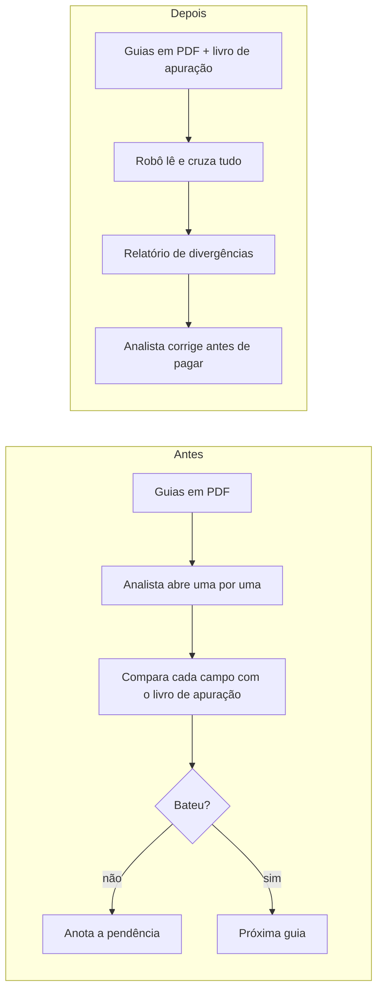

# Robô de Conferência Fiscal


Automação em Python que confere guias tributárias em PDF contra o livro de apuração em Excel e aponta as divergências **antes do pagamento**, quando corrigir ainda é simples e barato.

Desenvolvido durante meu estágio em Projetos & Inovação, numa empresa da área contábil. **Está em uso:** a analista que emite as guias roda o robô todo mês.

---

## Por que isso importa

Um erro em guia tributária não custa só retrabalho. Custa dinheiro:

| Erro na guia | Consequência |
|---|---|
| **Valor a menor** | Multa de mora e juros (Selic). Se o fisco encontrar o erro antes da empresa, vira multa de ofício, bem mais pesada |
| **Código de receita, UF ou CNPJ/IE errado** | O fisco pode não reconhecer o pagamento: o imposto continua **em aberto**, acumulando multa e juros, e o valor pago errado só volta por retificação ou restituição, que é demorada |
| **Débito em aberto** | Pode bloquear a **certidão negativa de débitos**, necessária para licitações, crédito e contratos |
| **Erro descoberto meses depois** | Exige processo administrativo (retificação, restituição ou defesa contra autuação) e, em alguns casos, judicial |

## Como era

Todo mês saem de **40 a 55 guias** (municipais, como o ISS, e estaduais). A conferência era **manual**: a analista abria guia por guia e comparava campo por campo com o livro de apuração. Em um trabalho repetitivo, é natural que um erro passe despercebido, e ele só aparecia depois, já com custo.



## O que o robô confere, e qual risco cada verificação evita

| Verificação | Como | Risco que evita |
|---|---|---|
| **Valor** | Busca o valor da guia no livro de apuração, com margem de tolerância configurável, priorizando as linhas já marcadas em vermelho como pendência | Recolhimento a menor (multa e juros) ou a maior (dinheiro parado) |
| **Código de receita** | Identifica o código fiscal da guia a partir de uma tabela de regras por filial | Pagamento não reconhecido e imposto em aberto |
| **CNPJ / IE** | Confirma que a guia é da filial certa | Pagamento em nome da filial errada |
| **UF de destino** | Lê a UF favorecida, adaptando a leitura aos 3 layouts de guia mais comuns | Imposto pago para o estado errado |
| **Guias parceladas** | Agrupa guias da mesma obrigação (como ISS da matriz) e confere o valor total | Diferença escondida na soma das parcelas |

## Resultado

O ganho principal não é tempo, é **evitar prejuízo**:

- Erros encontrados **antes do pagamento**, e não meses depois
- **100% das guias conferidas**, sem depender da atenção humana em um trabalho repetitivo
- Menos risco de multas, juros, pagamentos não reconhecidos e processos para corrigir guias já pagas

E, de quebra, a conferência que levava **cerca de 2 horas por mês** agora leva **segundos**. A analista revisa só o que divergiu.

## Como usar

1. Abra o programa e selecione o livro de apuração (Excel), a aba do mês, a planilha de regras e a pasta com os PDFs.
2. Clique em **Iniciar conferência**.
3. Acompanhe o log na tela e revise as divergências apontadas.

## Tecnologias

- **Python 3.10+**
- **pdfplumber:** leitura do texto dos PDFs
- **openpyxl:** leitura do livro de apuração, inclusive cores e formatação condicional
- **CustomTkinter:** interface para a analista operar sem usar o terminal

Os arquivos temporários ficam numa pasta própria, que é apagada ao fim de cada execução.

## Sobre esta versão pública

Esta é uma versão de portfólio. Os nomes de filiais e departamentos foram anonimizados, e parte da lógica de conferência foi resumida para proteger dados da empresa.

```text
├── robo.py     # leitura dos PDFs, regras e conferência
├── visual.py   # interface (CustomTkinter)
└── README.md
```

## Termos de uso

Todos os direitos reservados. Projeto com fins de portfólio. Cópia, distribuição ou uso comercial não são permitidos sem autorização.
